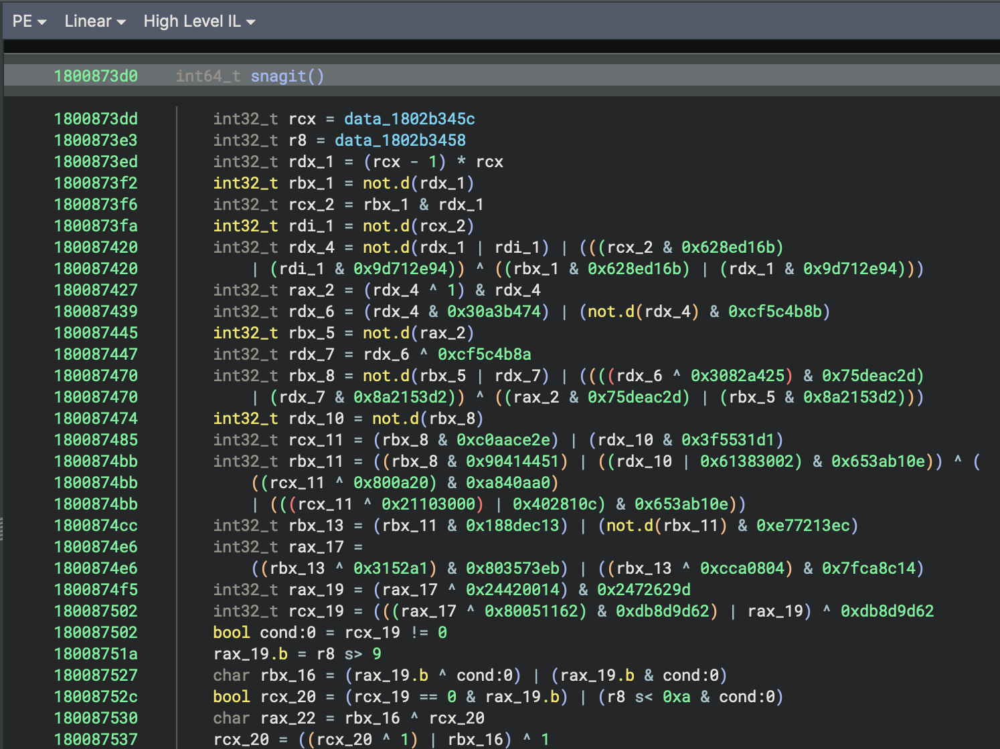
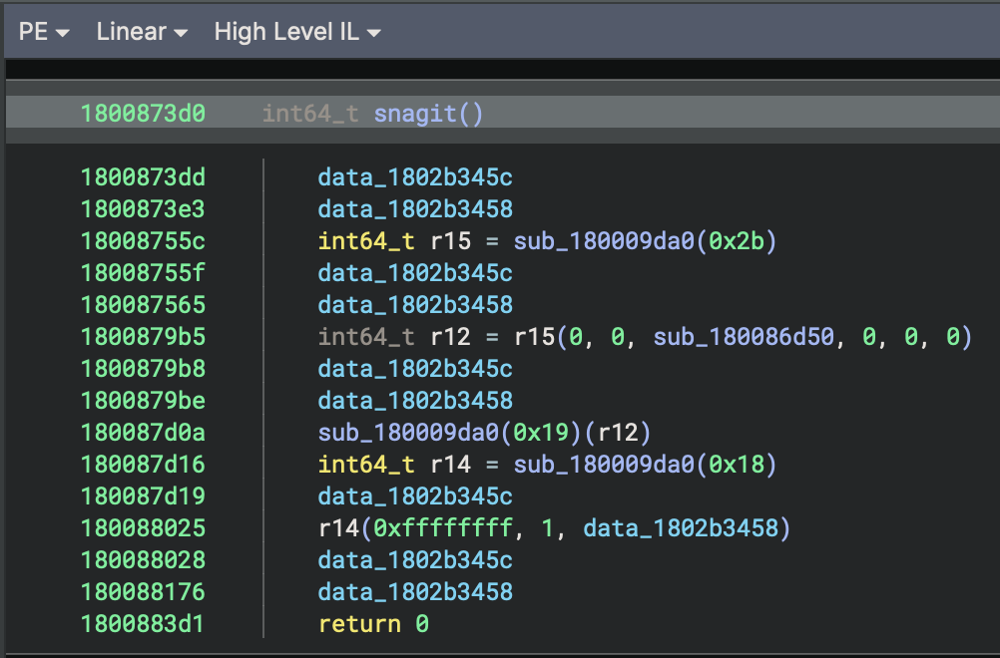
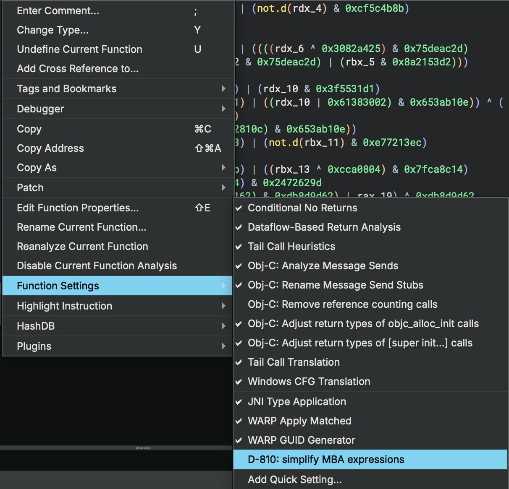
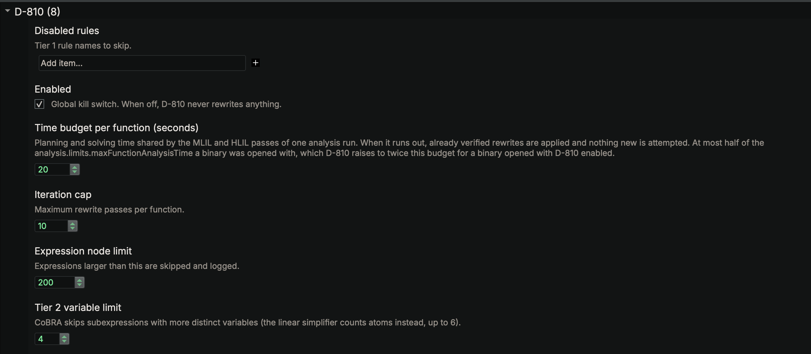
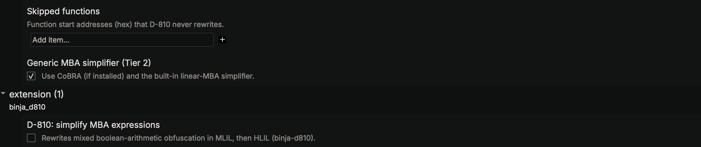

# D-810 for Binary Ninja

> Inspired by [D-810](https://github.com/joydo/d810) by eShard, with MBA rules from
> [d810-ng](https://github.com/w00tzenheimer/d810-ng).

A Binary Ninja plugin that cleans up mixed boolean-arithmetic (MBA) obfuscation, opaque
predicates and control-flow flattening. It turns junk like `(x ^ y) + 2 * (x & y)` back into
`x + y`, folds conditions that always go the same way (OLLVM-style bogus control flow) so Binary
Ninja drops the dead branches, and turns flattened state machines back into branches and loops.
Nothing is written to the binary.

Here's an export from an OLLVM-obfuscated DLL before (399 lines of HLIL):



And after (4 lines):



## What it handles

* MBA expressions, through D-810's rules, a built-in linear MBA simplifier, and
  [CoBRA](https://github.com/trailofbits/CoBRA) if you have it installed
* OLLVM-style instruction substitution, like `(x & y) | (x ^ y)` for `x | y`
* Arithmetic helpers with private register conventions, including nested helpers and proven
  scratch-slot round trips
* Dead private stack writes and non-escaping scratch accesses, including partial byte ranges
* Comparisons reconstructed from arithmetic flags and supported conditional-compare merges
* Private allocation round trips when explicit semantic contracts establish their memory behavior
* Bounded constant-input buffer computations, with decoded-text comments at their uses
* Opaque predicates, including ones hidden behind long chains of masked constants, ones that
  only hold on every path into a merge, values carried round loops, and the classic
  number-theoretic ones like `7 * y * y - 1 != x * x`
* Divisions that can never trap, like `2 / (x * x + 1)`
* Jumps and calls through encoded tables of code pointers (Hikari-style indirect branches and
  calls), including jumps back into the same function, and identity wrappers around them,
  when no visible code writes the table
* Constants encoded against a global key whose bytes are proven unwritten, like `x ^ key ^ 0x3c1d`.
  This includes bounded writes to neighboring buffers and helpers that only read the pointer,
  including returned pointers and whole local pointer slots whose later uses are proven safe.
* Control-flow flattening: state machines driven by compare trees or jump tables, including
  nested loops, and machines split across functions, where the dispatcher calls itself for the
  next state or calls a small function per state that returns through a stub back to it. Large
  handlers and their loops stay in place while the dispatcher is removed. Self-calls and outlined
  handlers can be recovered together, including dispatchers with large argument lists and
  undeclared register inputs that the handlers provably preserve. Known register and stack
  inputs can also be carried across handlers when their values and frame layout are proven
* Junk loops that only count a variable up to some value and then throw it away
* x86, x64 and ARM64 binaries (PE, ELF and Mach-O)

Every rewrite is checked before it's applied. Conditions are only folded when Z3 proves them,
and D-810's rules are only used at the bit widths Z3 proved them for. It runs in two passes,
MLIL then HLIL, and the HLIL pass picks up whatever MLIL couldn't express. Unflattening happens
in between, by copying code rather than guessing, so the program's behaviour doesn't change.

## Requirements

* Binary Ninja 6.0 (tested on 6.0 Personal, macOS arm64)
* `z3-solver` in Binary Ninja's Python
* Optional: CoBRA, through the `d810-cobra` package

## Install

Clone it and link it into your plugins folder:

```sh
git clone https://github.com/MZHeader/binja-d810
ln -s "$PWD/binja-d810/binja_d810" "$HOME/Library/Application Support/Binary Ninja/plugins/binja_d810"
```

Then install Z3 (and CoBRA if you want it) into Binary Ninja's Python, which is 3.13:

```sh
BN_SITE="$HOME/Library/Application Support/Binary Ninja/python313/site-packages"
uv pip install --python python3.13 --target "$BN_SITE" z3-solver
uv pip install --python python3.13 --target "$BN_SITE" --no-deps d810-cobra==0.1.7   # optional
```

Restart Binary Ninja. You should see `binja-d810: activities ... registered` in the log.

## Usage

It's off by default. Use **Plugins > D810 > Enable for Current Function**, or right-click the
function, go to **Function Settings** and tick **D-810: simplify MBA expressions**.
Both reanalyze the function straight away.



To run it on a whole binary, use **Plugins > D810 > Enable for This Binary**, or tick the same
option in **File > Open with Options** before opening it. The menu also has disable commands
for the current function and the whole binary; these undo D810's flow fixes. Your skipped-function
list and time budgets still apply. Functions without obfuscation are skipped almost instantly,
but heavily obfuscated ones can use their whole time budget each, so on big binaries it's often
quicker to enable it only for the functions you care about.

Every rewrite is logged under `binja_d810`. The log says **D810: analysis complete** once native
analysis and D810's queued changes have finished. Pass failures are reported as errors; budget
warnings still mean some work was left unfinished.

Use **Plugins > D810 > Show Function Report** for the latest report, or run this in the Python console:

```python
current_function.request_debug_report("d810")
current_function.reanalyze()
```

## Settings

Everything is under **Settings > D-810** and can be set globally or per binary. The on/off switch
itself lives in a separate **extension** group that Binary Ninja creates.





* **Time budget per function**: 20 s by default. Binary Ninja gives up on a function that takes
  too long to analyze, so when a binary is opened with D-810 on, its per-function limit is raised
  to twice the budget. The passes share that allowance; jump-table dispatchers keep up to half
  for control-flow recovery and HLIL cleanup. Table and type changes can trigger another run, so total
  time can exceed the budget.
* **Generic MBA simplifier (Tier 2)**: the linear simplifier and CoBRA. Turn it off to use the
  rules only.
* **Skipped functions** and **Disabled rules**: addresses and rule names to leave alone.
* **Flow fixes**: on by default. Resolves code-pointer tables and identity wrappers, and undoes
  it all when D-810 is turned off. Your own types and branch targets always win.
* **Unflatten control flow**: on by default. It only touches a function with a clear dispatcher:
  a loop over a state variable that's only ever set to constants. It also removes junk loops.
* **Pure-callee summaries**: on by default. Exposes arithmetic across helper calls before MLIL
  generation. Turn it off to restore the calls; the limits are listed below.
* **Clean up private scratch slots**: on by default. Removes proven dead stack traffic and
  exposes private loads/stores to the expression passes. Disabling it restores the original IL.
* **Recombine flag conditions**: on by default. Replaces proven flag formulas with comparisons
  in MLIL and HLIL, including bounded conditional-compare merges.
* **Simplify private allocation round trips**: on by default. Requires explicit semantic
  contracts; ordinary allocator names and signatures are insufficient.
* **Read-only ranges**: address ranges (`0x1000-0x1fff`, end included) to treat as constant. Use
  them for data you know never changes. Clearing a range puts the old types back.
* **Enabled**: a kill switch for everything.

## Arithmetic helpers

D810 reads the helper's lifted IL to find its register inputs and outputs, including registers
missing from its declared calling convention. It builds fixed-width expression summaries and
substitutes checked copies of the body at ordinary calls. The copies retain flag writes and
call/return stack effects. Unsupported effects, loops, tail calls and recursion stay unchanged.

Scratch stores need a byte-level proof that the caller cannot read or escape them. This currently
requires a straight-line caller whose other calls also have summaries. Partial overwrites do not
hide later reads. The stores are retained in the copied IL; this pass does not clear alias flags or
remove arbitrary stack writes. Fixed read-only loads are allowed; writable and relocated loads are not.

The default limits are:

| Setting | Default |
| --- | ---: |
| Callee instruction limit, including nested expansion | 64 |
| Callee expression limit | 2,000 nodes |
| Callee summary depth | 4 |
| Callee frame byte limit | 256 |
| Callee caller instruction limit | 4,096 |
| Callee call-site limit | 64 caller sites |
| Callee proof timeout | 500 ms |
| Callee red-zone byte limit | 128, capped by the platform ABI |

Depth bounds composition through the current IL; helpers simplified in an earlier analysis can
already be flatter. Summary planning and substitution share the function time budget.
Unknown and kernel platforms get no red-zone
allowance; setting its limit to zero disables that support. The ABI bounds come from the
[System V AMD64 specification](https://gitlab.com/x86-psABIs/x86-64-ABI/-/blob/master/x86-64-ABI/low-level-sys-info.tex)
and [Apple's ARM64 documentation](https://developer.apple.com/documentation/xcode/writing-arm64-code-for-apple-platforms).

**Prefer native callee inlining** is an optional comparison mode, off by default. For register-only
helpers it records a user inline flag and restores it when disabled. It needs Flow fixes for the
undo queue. Frame-dependent helpers continue to use direct substitution, since a global inline
flag would affect unproved callers too. Existing no-inline flags are respected.

The debug report's `callees` entries list substitutions and rejection reasons. Synthetic fixtures
cover ARM64, x86-64 and ordinary i686 calls at O0/O2, with independent arithmetic models and undo
checks. These tests do not establish coverage on real malware. Direct call-link substitution is
currently supported on those three architectures; other architectures are left unchanged.

## Private scratch slots

D810 follows stack addresses through copies and fixed offsets. When every use is accounted for,
it converts local loads/stores to variable accesses and clears their alias status in the generated
IL. It then removes a store only if no path can read any of its bytes before they are overwritten.
An additional SSA check preserves live logical values that happen to share a stack location.
Unused pure address calculations are removed with the stores.

Escaping addresses, unknown calls, volatile/protected slots and unmodeled memory accesses stay
conservative. Partial overwrites preserve the remaining bytes. Overlapping logical variables
keep their alias identities; partial accesses on big-endian targets are currently excluded.
The proof uses exact byte ranges and all CFG paths, without guessing which branch will run.

Cleanup runs before MBA rewriting and after control-flow recovery, under the shared function
budget. Its settings are:

| Setting | Default |
| --- | ---: |
| `binja_d810.scratchSlots` | true |
| `binja_d810.scratchInstructions` | 20,000 instructions |
| `binja_d810.scratchNodes` | 40,000 proof nodes per round |
| `binja_d810.scratchFrameBytes` | 4,096 distinct stack bytes |
| `binja_d810.scratchLivenessVisits` | 100,000 fixpoint visits |
| `binja_d810.scratchRounds` | 4 rounds per cleanup stage |
| `binja_d810.scratchAddressDepth` | 64 SSA definitions |

The report's `scratch` entries show removed stores, promoted accesses, cleared aliases and
rejection reasons. No user types or binary bytes are changed; disabling the feature regenerates
the original aliases. Synthetic ARM64, x86-64 and i686 fixtures check independent arithmetic
models, escapes, partial overlaps, budgets and disable/restore. One i686 PE O2 partial-store
fixture exposes an existing native MLIL error that loses the upper bytes before D810 runs;
the suite records it as an expected failure and separately checks that D810 preserves the baseline.
These fixtures do not establish coverage on real malware.

## Flag conditions

D810 rebuilds signed and unsigned comparisons from pure boolean and arithmetic expressions.
For conditional compares, it follows the actual SSA values leaving each arm of a branch and
combines them with the branch condition. It checks every proposed expression at its exact
bit widths, then removes newly unused flag calculations. A flag also used as external data
keeps that use and blocks the dependent rewrite.

The native passes read IL semantics, without matching register or symbol names. A small
subtraction model isolates ARM64's no-borrow carry convention from x86's borrow convention;
unit tests prove all ten comparisons at several widths. Native C fixtures cover all eight
ARM64/x86-64/i686 builds, with an independent symbolic interpreter checking complete branch
paths and observable stores. On x86-64, ordinary compare chains are often already simplified
by Binary Ninja. The ARM64 unsigned conditional-compare fixture loses its merged flag locals.

Supported merges are bounded two-arm branches, including one empty arm. Loops, ambiguous
merges, stale operands, volatile/protected values and unknown flag operations stay unchanged.
In particular, native `ADD_OVERFLOW` is currently unmodeled: some ARM64 signed conditional
compares retain their flag locals. Its semantics are not guessed from the displayed expression.
Explicit arithmetic overflow formulas are supported and proven. These are synthetic results;
no real-malware coverage is claimed.

| Setting | Default |
| --- | ---: |
| `binja_d810.flagConditions` | true; disable to restore the original conditions |
| `binja_d810.flagInstructions` | 20,000 instructions |
| `binja_d810.flagNodes` | 2,000 expression nodes |
| `binja_d810.flagWork` | 80,000 proof visits per pass |
| `binja_d810.flagCandidates` | 128 comparison attempts per expression |
| `binja_d810.flagConditionsPerPass` | 128 condition roots |
| `binja_d810.flagMergeDepth` | 8 nested merges |
| `binja_d810.flagProofMilliseconds` | 200 ms per proof |

Both stages share the function's time budget. The `flags` report entries list successful
recombinations and rejection reasons. These are regenerated IL edits, with no binary or user
metadata changes.

## Private allocation round trips

D810 can forward a private object's loads from preceding stores, including partial overlaps.
It proves all pointer uses, rejects escapes and observations of the pointer's numeric value,
and keeps unknown calls, memory effects and control-flow crossings conservative. Constant-size
and pointer-forwarding call/tail-call wrappers are checked from their MLIL bodies.

This needs a contract guaranteeing fresh, ordinary, nonnull storage. Removing the allocation,
stores and release also requires an explicit guarantee that the complete lifetime is unobservable,
including failure, exceptions and effects on later allocations. Without that stronger guarantee,
only loads are forwarded; calls and stores remain. Possible allocation failure retains the original
memory accesses. A null check does not authorize deletion of its failure path.

The installed type libraries we tested supplied signatures but no such effect guarantees.
D810 does **not** identify allocators by names such as `malloc` or `free`. Contracts can come from
the `binja_d810.memory` type attribute or explicit per-function metadata. Binary Ninja currently
drops custom attributes when rebuilding some function signatures, so metadata is the reliable
way to supply a verified contract. For a selected allocator with the required guarantees:

```python
current_function.store_metadata("binja_d810.memory",
    '{"version":1,"role":"allocate","parameter":0,"fresh":true,"ordinary":true,"nonnull":true,"elidable":false}')
```

`parameter` is the zero-based size argument. A release uses
`{"version":1,"role":"deallocate","parameter":0,"elidable":false}`, where the parameter is
the object pointer. Set `elidable` on both contracts only when the stronger lifetime guarantee
has been established. Reanalyze the callers after changing contracts. D810 reads these user-owned
contracts and leaves them intact when disabled; it makes no user type or binary changes.

| Setting | Default |
| --- | ---: |
| `binja_d810.allocationRoundTrips` | true; disable to restore the original IL |
| `binja_d810.allocationInstructions` | 20,000 instructions |
| `binja_d810.allocationNodes` | 40,000 proof visits |
| `binja_d810.allocationSites` | 64 calls |
| `binja_d810.allocationBytes` | 4,096 bytes per object |
| `binja_d810.allocationWrapperInstructions` | 64 instructions |
| `binja_d810.allocationWrapperDepth` | 4 wrappers |
| `binja_d810.allocationExpressionNodes` | 2,000 nodes |
| `binja_d810.allocationContractBytes` | 4,096 UTF-8 bytes |

The pass shares the function deadline. The `allocations` report lists forwarded loads, removed
lifetimes and rejection reasons. Synthetic C fixtures cover ordinary imported allocation calls,
boxed-value wrappers, partial writes, escapes, pointer observations, missing guarantees and undo
on all eight builds. Elision tests explicitly assume infallible, unobservable test contracts;
they do not prove those properties for a real allocator or for malware. Unannotated library
allocations remain unchanged.

## Constant buffers and decoded text

`binja_d810.constantBuffers` (default **true**) evaluates a deterministic MLIL region near
function entry. Scalar arithmetic, bounded loops, immutable image reads and local byte stores
are evaluated at their actual widths. The pass replaces that region with its final stores and
preserves register writes and live values. A retained path that can reenter the region vetoes
the change. Calls, unknown inputs, writable reads, pointer-bit observations and unmodeled effects
stop evaluation. It never executes the binary or calls a helper.

This is exact concrete evaluation of the input IL, with separate control-flow and live-out
checks. String recognition is a display heuristic: printable ASCII ending in NUL, or a buffer
followed by a constant length argument. The computed bytes are known; the callee's interpretation
of them is not assumed. The debug report records steps, text and rejection reasons.
`binja_d810.constantBufferComments` (default **true**) controls the comments. They use native
undo, preserve user edits, and are removed when the feature or D810 is disabled. Comments
require Flow fixes; IL evaluation does not. No binary bytes change.

Limits share the function time budget. Each key below has the `binja_d810.` prefix:

| Setting | Default |
| --- | --- |
| `constantInstructions` | 4,096 MLIL instructions |
| `constantExpressionNodes` | 2,000 nodes per expression |
| `constantSteps` | 10,000 executed instructions |
| `constantTrips` | 256 visits per instruction |
| `constantFrameBytes` | 4,096 bytes of local frame |
| `constantProofWork` | 100,000 proof visits |
| `constantRegionStarts` | 64 entry-block starting positions |
| `constantAnnotationSteps` | 4,096 retained-tail instructions |
| `constantScalarBits` | 128 bits |
| `constantStringBytes` | 256 bytes |
| `constantStringMinimum` | 4 printable bytes |
| `constantStoreBytes` | 8 bytes per emitted store; maximum 8 |

The current pass handles one entry region, not arbitrary regions after unknown calls. SIMD,
floating arithmetic, unknown pointer bytes and ambiguous logical/physical stack overlaps stay
unchanged. Native synthetic constant-copy operations are identified from their IL metadata and
original stores, never by library name. Their bytes have already been computed by Binary Ninja.

Tests generate rotate/multiply/add/XOR streams from 16 randomized seeds in loop and unrolled
forms, built for ARM64, x86-64 PE/ELF and i686 at O0/O2. Final IL bytes are read back independently
and compared with the Python generator. Fixtures disable compiler vectorization and stack
protectors to test scalar semantics. Three x86 O2 cases currently have incorrect native
constant-copy bytes **before D810**; strict expected failures record that limitation and check
that D810 preserves the original IL's bytes. These tests make no real-malware coverage claim.

## Notes

* D-810 removes the global reads its folds leave unused. Bare `data_...` lines that were there
  before it ran are left alone. They're harmless.
* Calls through resolved API pointers can show extra arguments, because Binary Ninja guesses them
  from whatever registers happen to be set. Giving the pointer a type fixes it.
* Unflattening can leave a flag-like compare behind when the next state is picked before a loop,
  or kept in two places at once. Machines that compute their next state are left alone.
* State functions pulled into their dispatcher are copied, not moved, so they're still there for
  anything else that calls them. Unoptimized builds that widen a state function's result on the
  way out keep their calls. Unmodeled stack/frame inputs and clobbered hidden registers also
  keep their calls.
* Table resolution checks the decoded targets and any visible writes to the table, but it can't
  see changes made by a loader. The debug report says why a table was rejected.

## Tests

```sh
uv sync && uv run pytest    # unit tests, no Binary Ninja needed
tests/samples/build.sh      # build the sample binaries (needs Homebrew LLVM for PE/ELF)
scripts/binja_pytest.sh     # integration tests, in a hidden Binary Ninja instance
```

The integration tests need `pytest` installed in Binary Ninja's Python too.

## License

AGPL-3.0, since the rules in `binja_d810/third_party/d810/` come from d810-ng (re-download them
with `scripts/vendor_d810.py`). CoBRA is Apache-2.0 and isn't included.
